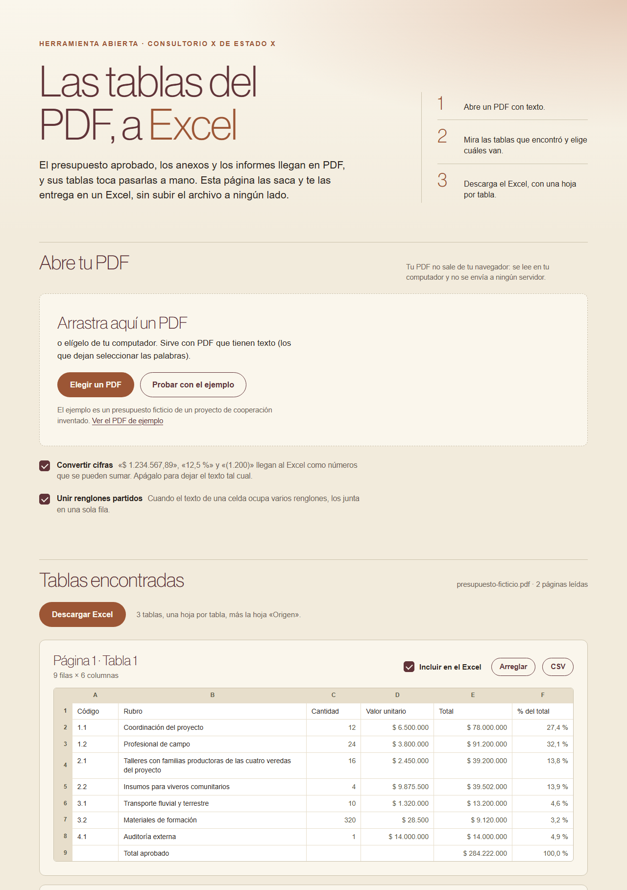

# Las tablas del PDF, a Excel · Colombia

[Español](#español) · [English](#english)



## Español

Una herramienta gratis y abierta que saca las tablas de un PDF con texto y las entrega en un Excel, con las cifras colombianas como números, sin subir el archivo a ningún lado. Es para equipos de cooperación, ONG, fundaciones, universidades y proyectos que reciben el presupuesto aprobado, los anexos y los informes en PDF y los pasan a mano al Excel.

**Ábrelo aquí:** https://estado-x.github.io/tablas-pdf-a-excel-colombia/

### Qué hace

- Abre un PDF (arrastrado o elegido) y busca sus tablas, página por página.
- Muestra cada tabla encontrada (página, número, filas y columnas) para que elijas cuáles van. Si algo quedó partido, puedes unir una fila con la de arriba, una columna con la de su izquierda o quitar una fila que sobra.
- **Convertir cifras:** lee «$ 1.234.567,89», «1.234.567», «12,5 %» y los negativos entre paréntesis como números de verdad, para que el Excel sume. Se puede apagar para dejar el texto tal cual.
- Descarga un Excel (`.xlsx`) con una hoja por tabla («Pág 3 · Tabla 1») y una hoja «Origen» con el nombre del archivo, la fecha y las páginas leídas. También un CSV por tabla.
- Si el PDF es escaneado, lo dice: «Este PDF es una imagen; esta herramienta solo lee PDF con texto».
- Trae un PDF de ejemplo ficticio (`ejemplos/presupuesto-ficticio.pdf`) y el botón «Probar con el ejemplo».

### Cómo funciona

Todo pasa en tu navegador: no hay servidor, cuentas, claves ni rastreadores, y la página no pide nada a internet mientras la usas.

1. [pdf.js](https://github.com/mozilla/pdf.js) (incluida en `assets/vendor/pdfjs/`) lee el texto de cada página con su posición.
2. `assets/tablas.js` agrupa el texto en renglones por su altura en la página; los renglones seguidos con varias celdas forman una tabla candidata, y las franjas verticales donde ningún renglón tiene texto son los cortes entre columnas. Tolera títulos que abarcan varias columnas y junta los renglones de una celda cuyo texto no cupo en una línea. El texto en diagonal (marcas de agua) se ignora.
3. `assets/cifras.js` reconoce las cifras escritas a la colombiana. Lo que no es claramente una cifra se queda como texto: fechas, NIT con dígito de verificación («900.123.456-7»), códigos como «1.1» o «007». Un NIT o una cédula sin dígito de verificación («900.123.456») sí llega como número. El formato se decide por columna: si una columna trae cifras que solo pueden ser de Estados Unidos («12,000.50»), toda se lee con coma de miles y punto decimal; si mezcla los dos formatos, se deja entera como texto.
4. `assets/excel.js` y `assets/zip.js` arman el `.xlsx` sin librerías. Un texto que empiece por `=`, `+`, `-` o `@` se guarda como texto, nunca como fórmula.

| Archivo incluido | Versión | SHA-256 |
|---|---|---|
| `assets/vendor/pdfjs/pdf.min.mjs` | pdfjs-dist 6.4.299 (`legacy/build`) | `bccc24ea711db8e44503629519904a5292d73b9daaa214bbe7cdcc282b0f4259` |
| `assets/vendor/pdfjs/pdf.worker.min.mjs` | pdfjs-dist 6.4.299 (`legacy/build`) | `145d2dd3ab0c86151011dba95acfa2d5336e2accd59388ea43dbee0efddaaec6` |

Los dos archivos vienen sin cambios del paquete oficial `pdfjs-dist@6.4.299` de npm (SHA-1 del paquete: `4a46f5146ac6505564c1a5d472900be4df8bf628`), con su licencia al lado.

### Úsalo o adáptalo

La rama es `main`. Es una página estática: basta con servir la carpeta.

```bash
git clone https://github.com/Estado-X/tablas-pdf-a-excel-colombia.git
cd tablas-pdf-a-excel-colombia
python -m http.server 8000
# abre http://localhost:8000
```

Abrir `index.html` con doble clic no sirve: el navegador no deja cargar la biblioteca de PDF desde `file://`. Para publicarla, activa GitHub Pages sobre `main`, carpeta raíz.

Para correr las pruebas (Chromium de verdad, con Playwright):

```bash
pip install playwright openpyxl reportlab
python -m playwright install chromium
python pruebas/probar.py
```

El PDF de ejemplo se vuelve a crear con `python ejemplos/generar_ejemplo.py`.

### Límites

- No lee PDF escaneados (imágenes). Hay que pasarlos antes por un reconocimiento de texto (OCR) en tu computador.
- No garantiza que cada celda quede en su sitio. Las tablas con celdas combinadas, sin columnas claras o con columnas que casi se tocan pueden salir corridas; el texto en dos columnas de una página puede parecerle una tabla.
- No corrige los datos: lo que venga mal en el PDF sale igual en el Excel.
- Una tabla que sigue en la página siguiente sale como dos tablas, una por página.
- Presupuestos en dólares: una columna con cifras como «12,000.50» se lee completa en formato de Estados Unidos. Pero si la columna solo trae cifras como «250,000» o «1,500» (comas y grupos de tres dígitos, sin punto decimal), no se puede saber si son miles o decimales: esas celdas se quedan como texto. Una columna que mezcla los dos formatos también. Las fechas se dejan como texto.
- PDF con clave: hay que guardarlos sin clave primero. Lee hasta 500 páginas y archivos de hasta 150 MB.
- **Dónde entra tu criterio:** antes de usar el Excel, revisa que sus totales cuadren con los del PDF.

### Crédito

- Inspirado en [Camelot](https://github.com/camelot-dev/camelot), de camelot-dev (licencia MIT); no reutiliza su código. Está escrito desde cero para el navegador.
- Incluye [pdf.js](https://github.com/mozilla/pdf.js), de Mozilla (licencia Apache-2.0): `assets/vendor/pdfjs/`, con su `LICENSE`.
- El escritor de Excel y de zip viene de [facturas-colombia](https://github.com/Estado-X/facturas-colombia), de Estado X (licencia MIT).
- El PDF de ejemplo es ficticio: el proyecto, las entidades y las cifras son inventados.

### Hecho por Estado X

Licencia MIT (pdf.js conserva su licencia Apache-2.0). Esta herramienta es una muestra de lo que montamos en Consultorio X de Estado X con equipos que ejecutan proyectos. Para hablar de tu caso, escríbele a Juan Camilo Pérez Cuervo en LinkedIn: https://www.linkedin.com/in/juanperezcuervo/

## English

A free, open tool that pulls the tables out of a text PDF and gives them back as an Excel file, reading Colombian-style figures as real numbers, without uploading the file anywhere. Built for cooperation teams, NGOs, foundations, universities and projects that receive approved budgets, annexes and reports as PDFs.

**Open it here:** https://estado-x.github.io/tablas-pdf-a-excel-colombia/

- **What it does:** opens a PDF, detects tables page by page, previews each one (page, table number, rows and columns), lets you choose which to export and fix split rows or columns, and downloads a real `.xlsx` with one sheet per table plus an "Origen" sheet (file name, date, pages read). CSV per table too. The "Convertir cifras" option reads `$ 1.234.567,89`, `12,5 %` and negatives in parentheses as numbers; turn it off to keep the text as is. Scanned PDFs get a clear message instead of an empty result.
- **How it works:** everything runs in the browser. [pdf.js](https://github.com/mozilla/pdf.js) (vendored in `assets/vendor/pdfjs/`, pdfjs-dist 6.4.299, hashes above) extracts text with positions; `assets/tablas.js` groups it into rows by vertical position and into columns by the vertical gaps no row writes into; `assets/excel.js` and `assets/zip.js` write the workbook without libraries. No server, accounts, API keys or trackers, and no network requests while you use it. Text starting with `=`, `+`, `-` or `@` is always stored as text, never as a formula.
- **Use or adapt it:** static site on the `main` branch. Serve the folder (`python -m http.server 8000`); opening `index.html` from `file://` won't load the PDF library. Tests: `python pruebas/probar.py` (Playwright, openpyxl, reportlab).
- **Limits:** it doesn't read scanned PDFs, doesn't guarantee every cell lands in the right place (merged cells, unclear columns), and doesn't fix the data. A table that continues on the next page comes out as two. The number format is decided per column: a column containing unmistakably US-style figures (`12,000.50`) is read entirely as US-style; figures that are ambiguous on their own (`250,000`, `1,500`) stay as text, and so does a column mixing both styles. Dates stay as text. Always check that the totals in the Excel match the PDF before using it.
- **Credit:** inspired by [Camelot](https://github.com/camelot-dev/camelot) by camelot-dev (MIT), written from scratch for the browser; it doesn't reuse its code. Bundles [pdf.js](https://github.com/mozilla/pdf.js) by Mozilla (Apache-2.0). The sample PDF is fictitious.

Made by Estado X · MIT license (pdf.js keeps its Apache-2.0 license).
